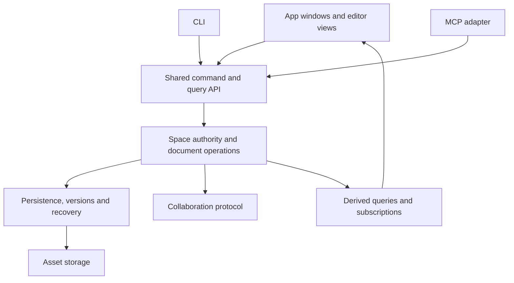

# System architecture and ownership

Status: proposed boundaries. Technology and process topology await qualification.

## Proposed system

A document session belongs to the Space authority, not a webview. Different
windows hold projections and pending local input, not separate writable domain
models. The editor adapter maps engine transactions into shared operations and
maps accepted operations back without resetting composition, selection or undo.
The editor's required internal representation is a projection, not another
independently persisted source of truth.

The proposed local topology is a headless-capable authority per open Space,
shared by all local clients. App, CLI and MCP attach to it; headless invocation
can start it without a window. Runtime language, IPC, startup election, lock
ownership and crash takeover remain decisions. A singleton inside a webview is
insufficient. SQLite locking alone does not coordinate live sessions.

## Ownership table

| Owner                         | Authoritative responsibility                                                                                            | Must not own                                          |
| ----------------------------- | ----------------------------------------------------------------------------------------------------------------------- | ----------------------------------------------------- |
| Application coordinator       | Window lifecycle, Space registry, global preference mutations and service discovery                                     | Document bodies or a second mutation pipeline         |
| Space authority               | Document/organisation operations, validation, revisions, assets, access decisions and ordering within the local replica | Cursor, scroll or tab history                         |
| Document session              | Accepted live document state, pending durability, operation mapping and conflict lifecycle                              | Independent storage format or window layout           |
| Persistence subsystem         | Atomic durable commit, retained versions, recovery records, migrations and backup consistency                           | UI state or independent business validation           |
| Collaboration subsystem       | Replica identity, operation exchange, deduplication, causal ordering and convergence                                    | Separate document semantics or implicit access grants |
| History subsystem             | Retained versions/checkpoints and restore planning through shared operations                                            | Interactive undo or an alternate current document     |
| Editing context               | Undo/redo metadata and origin grouping for one document/context                                                         | Another participant's history or canonical content    |
| Window                        | Layout, focused pane and window-specific navigation                                                                     | Shared content/preferences                            |
| Pane                          | Tab collection and active tab                                                                                           | Document lifetime                                     |
| Tab                           | Destination IDs and back/forward navigation                                                                             | Unsaved text or document identity                     |
| Editor view                   | Selection, cursor, focus, scroll and temporary interaction state                                                        | Canonical document or persistence                     |
| Derived query/index subsystem | Revision-tagged search/backlink/task projections                                                                        | Sole copy of tasks, links or content                  |
| CLI/MCP/UI adapters           | Protocol translation, presentation and caller context                                                                   | Duplicate domain policy or direct storage writes      |

A role may be a module rather than a separately deployed service. Avoid a generic
framework until concrete contracts require one. Composition roots wire owners;
they do not reimplement decisions.

## Single authority with collaboration

One local authority does not imply one global mutable document instance. Multiple
people have durable replicas. One shared merge model must define how accepted
operations converge; no client invents an independent last-writer-wins policy.
Membership authority and revocation rules must also be settled. A server's
ordering, a CRDT and a database transaction solve different problems.

Store the canonical collaborative representation once; rendered semantic
snapshots, materialized tables and indexes are derived at identifiable revisions.
If operation history is canonical, a JSON snapshot cannot become an unrelated
second authority. The exact choice is open in ADR-F004.

## Operation lifecycle

1. An adapter submits explicit target IDs, caller identity, origin/context,
   preconditions, schema version and an operation ID.
2. The authority checks permission, target state, deduplication and revision or
   causal preconditions, then validates the proposed semantic change.
3. It applies one ordered change or rejects it. A stale whole-document replacement
   cannot overwrite unseen edits. Optimistic view input is provisional until accepted.
4. Persistence records the required durable state, provenance, history boundaries
   and operation outcome. Atomic multi-document operations have an explicit scope.
5. The caller receives acceptance/durability status. Subscribers receive a revision
   hint or mapped operation. Indexes expose their applied revision.
6. Missed notifications trigger catch-up or snapshot reconciliation. A duplicate
   event is harmless. An interrupted caller can query the operation outcome.

Interactive acceptance may precede durability; that interval must be measured
and protected. External mutation commands default to awaiting durable completion.
Uncertain completion is not reported as definite failure or retried with a new ID.
Recovery restores pending operations as pending, not fabricated durable versions.

## Data and lifecycle boundaries

- Content, metadata, links and tasks share a semantic mutation boundary. Derived
  rows carry the source revision and can be rebuilt.
- Immutable media publication precedes a committed reference, or a staged protocol
  must repair interruption. Backups and garbage collection use consistent roots.
- Layout writes cannot mark content saved, replace sessions or delete recovery.
- A session remains alive until pending work is durable/protected even with zero
  views. Idle eviction requires proven clean state and no required undo/context lease.
- Disk full, access loss, owner crash, deleted targets and unsupported migrations
  have explicit results. Prevent stale completions from resurrecting closed sessions.
- Same-device multi-process access and remote collaboration require separate tests;
  sharing a filesystem over network/cloud-sync is not an approved collaboration protocol.
