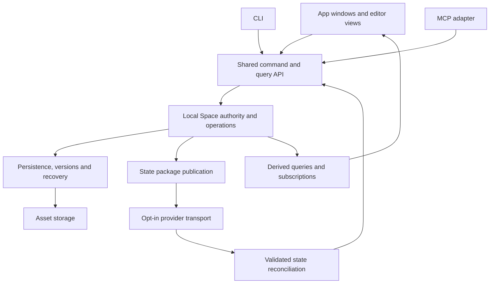

# System architecture and ownership

Status: proposed mechanisms under confirmed product scope, revision 0.7.
See [product behaviour](product-behaviour.md) for entity rules and
[sync and portability](sync-and-portability.md) for provider/phase boundaries.

## Proposed system

No Clutter-hosted service or initial live-collaboration backend is implied.
Provider transport is optional and unqualified. The active local database is
not the transported multi-writer file. Outbound publication consumes coherent
durable state; inbound packages go through shared reconciliation/validation.

A session belongs to the local Space authority, not a webview. The editor has
its necessary engine state/provisional input, but no independent persisted body.
Accepted operations map between core and views without resetting input/selection.
The authority is headless-capable, shared by app/CLI/MCP and local windows;
language, IPC, startup election and takeover remain D-04. Database locking alone
does not coordinate multiple frontend live sessions.

## Ownership table

| Owner                         | Authority                                                                   | Not an independent owner of                             |
| ----------------------------- | --------------------------------------------------------------------------- | ------------------------------------------------------- |
| Application coordinator       | Space registry, global settings, window lifecycle and discovery             | Document bodies                                         |
| Local Space authority         | Entity/domain commands, validation, IDs, local ordering and access          | Selection/navigation                                    |
| Document session              | Accepted live state, pending durability, mappings and conflict boundary     | Separate storage format                                 |
| Task entity/placement policy  | Task content/fields and sole note-or-inbox placement invariant              | A copied body per projection                            |
| Persistence subsystem         | Atomic durable changes, outcomes, recovery, tombstones and schema migration | Duplicate business policy                               |
| History subsystem             | Retained/pinned/overwritten states, closure and restore planning            | Current state or interactive undo                       |
| Provider reconciler           | Apply one shared state-ordering/ingest policy through domain API            | Direct DB writes or a second merge model                |
| Provider transport adapter    | Transfer/availability/credential mechanics                                  | Winner selection, task generation or permissions policy |
| Scheduler policy              | Dates, recurrence/occurrence identity and reminder eligibility              | UI-local duplicate task/reminder logic                  |
| Platform notification adapter | OS delivery of eligible reminders                                           | Independent task schedule                               |
| Editing context               | Undo/redo origin/grouping and mapping metadata                              | Another context's edits                                 |
| Window / pane / tab           | Layout / tab set / destination and navigation respectively                  | Pending canonical content                               |
| Editor view                   | Cursor/selection/scroll/focus and temporary interaction                     | Document lifetime                                       |
| Derived queries               | Rebuildable search/backlink/task/collection views                           | Sole copy of tasks or inferred custom-property schema   |
| UI/CLI/MCP adapters           | Protocol/presentation/context translation                                   | Domain rules/storage writes                             |

These are logical responsibilities, not instructions to create one service/class
per row. Use concrete modules at the necessary boundaries, with one owner per rule.

## Entity and representation boundaries

Notes, daily notes, template copies and task pages share semantic editing concepts
without becoming interchangeable identities. A task has one content owner and
one location; its block/Tasks/page appearances point to it. Whether task payload
is stored in its owning aggregate or a separate entity is D-02. Either must
preserve ID/history on move and prevent duplicate ownership through sync/restore.

Custom properties belong to each note/task. Collections have predefined fields;
no dynamic schema inference/global custom-property registry is introduced. Read-only
page embeds render their target rather than persist/edit another canonical copy.

Task completion, next-occurrence generation and historical preservation need one
idempotent domain operation. Provider ingest must not generate the next occurrence
again merely by observing an already-completed state. Task moves/cascades and
state publication require a coherent cross-entity transaction/reconciliation unit.

## Operation lifecycle

1. Adapter submits explicit Space/target IDs, operation ID, origin/context, version,
   payload and expected revision/preconditions. Validate the local access boundary.
2. Authority validates intent, deduplication and current target state. Local stale
   replacement is rejected; a remote competing document state is handled under
   the separate latest-state-wins reconciliation contract with retained history.
3. Apply one valid local change or refuse. Protect unsaved/input composition before
   remote replacement. Context undo has a defined boundary at state replacement.
4. Persist affected state, history/provenance/required assets, outcome and durable
   pending-publication intent atomically
   within the selected backend scope, or use an explicit recoverable staged protocol.
5. Report local acceptance/durability separately from provider transfer status;
   update revision-tagged subscribers/indexes. Publish
   only coherent durable state packages if provider sync is enabled.
6. Catch up by revision after lost events/reconnect. Duplicate messages/operations
   do not create repeated tasks or destroy historical states. Query uncertain outcomes.

Interactive acceptance may precede durability; expose and protect that interval.
External commands default to awaiting durability. Timeout/uncertainty is not proof
of failure; retry with the same operation ID/outcome lookup, not a new mutation.

## Platform and future boundaries

Keep local domain/persistence/history/scheduler/sync policy and CLI/MCP contracts
independent of native UI/services. Compose macOS implementations at boundaries;
Windows should add adapters and native tests without reorganizing the shared core.

Retained history, recovery, trash and pins govern asset roots. Provide a consistent
snapshot boundary for future backup; no automatic scheduler now. Keep a versioned
operation/protocol seam for future live collaboration, without selecting CRDT,
server, identity provider or encryption in this documentation pass.

A successful local save cannot be forgotten by the uploader after restart. Inbound
validation/current-state changes/history and catch-up progress must be replay-safe.
The detailed outbox/status/process lifetime contract lives in
[sync and portability](sync-and-portability.md), not independently in each adapter.

## R03 contract boundary

[Document model](document-model-spec.md) defines logical entity/placement/content
ownership and DM-01–DM-15 invariants; [command specification](command-api-spec.md)
and [operation/scenario catalogue](model-api-contract-cases.json) define the shared
mutation/query boundary. These are conditional proposals, not a selected physical
schema or implementation. In particular, body structure and task location each have
one authoritative relation; reverse indexes/views do not become independent writers.

R02 Q-01–Q-09 and model M-01–M-07 remain explicit. R04 must prove persistence of
coherent effect sets, outcomes/history and outbox rather than treating these names
as an already transactional architecture. Provider task-placement coherence remains
a separate enablement blocker; no library/database is accepted by the R03 draft.

## R04 persistence reference

[Vault persistence](vault-persistence-spec.md) owns the detailed commit/acknowledgement,
asset/root, history/recovery and outbox durability contract. It compares backend
encodings and records PS decisions rather than selecting a backend. Read models
and notifications follow committed/protected state; they are never the sole copy
of accepted canonical entities. No native crash or storage guarantee was qualified
by preparing this specification.

## R05 provider qualification boundary

Provider adapters remain subordinate to core validation/reconciliation. See the
[protocol](provider-sync-spec.md) for package/effect ownership and SY-04, which blocks
provider enablement until coherent task reconciliation is selected and tested.

## R06 qualification preparation

[Platform proposal](platform-boundaries-spec.md) owns startup/lifetime/ownership,
provisional-input reconciliation and PL decisions. [Local security](local-security-api-spec.md)
owns transport/grants and SEC decisions. These are conditional contracts, not an
accepted host language/topology. Every existing component may be replaced.
