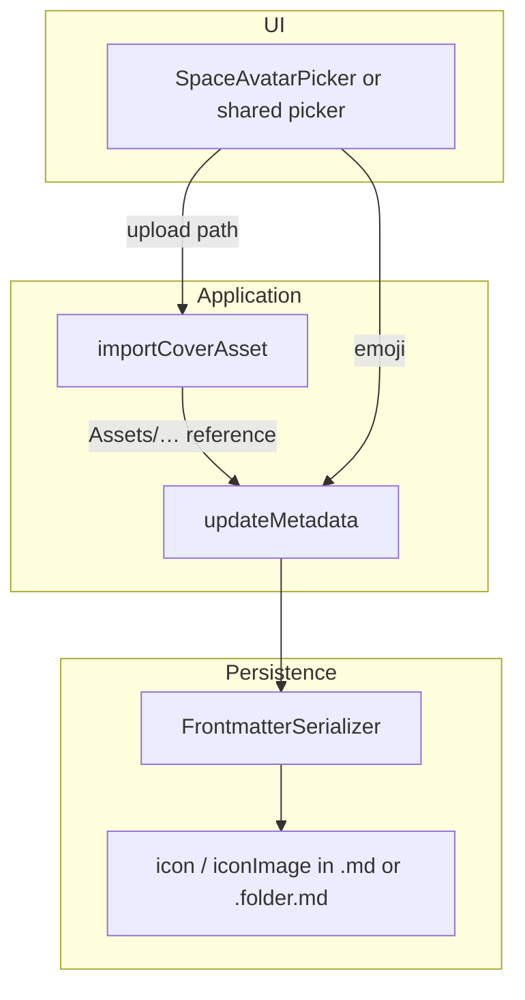

# Page title icon images — investigation and implementation plan

**Status:** Deferred — not implemented. Use this document when resuming work.

**Goal:** Extend the Page Title section so users can choose either an **emoji** (existing) or an **uploaded image**, reusing the Space avatar picker pattern and the existing asset import pipeline. Do not duplicate upload logic or store absolute paths / Base64 in frontmatter.

---

## Current behavior

- Page and folder headers show a user-set **emoji** in a 72×72 slot (`PageHeaderControls`).
- Persistence: frontmatter key `icon` → `PageMetadata.icon` / `FolderMetadata.icon` (`string | null`).
- Write path: `PageOperations.updateMetadata` / `FolderOperations.updateMetadata` only.
- UI: `ChangeIconPicker` (emoji-only `Popover` + `EmojiTray`); `PageHeaderMoreActionsMenu` offers Emoji when no icon is set.

---

## Phase 1 — Existing architecture (reference)

### Space avatar (reuse target)

| Piece | Location | Role |
|--------|----------|------|
| `SpaceAvatarPicker` | `components/space-avatar-picker/` | Emoji / Image tabs, Remove; `EmojiTray` + `ImagePickerUpload` |
| `SpaceAvatar` | `components/space-avatar/` | Renders emoji or image; `onError` → initial fallback |
| `ImagePickerUpload` | `app/layouts/page/cover/image-picker/` | Tauri file dialog → absolute path |
| `Application.applySpaceProfile` | `core/application/Application.ts` | Image → `importCoverAsset` → vault-relative `src` in `workspace.json` |
| `SpaceProfileStore` | `core/application/space/SpaceProfileStore.ts` | Typed `{ type: 'emoji' \| 'image', … }` in `.clutter/workspace.json` |

`SpaceAvatarPicker` is **upload-only** (no vault asset browser) by design for spaces without a vault yet.

### Asset import pipeline (single path)

```text
ImagePickerUpload → absolute path
  → Application.importCoverAsset(sourceAbsolutePath)
  → importCoverAsset → importAsset(fileSystem, vaultRoot, sourceAbsolutePath)
  → Assets/ with collision-free name
  → returns vault-relative reference (e.g. Assets/photo 2.png)
  → VaultSyncService.reconcileKnownPath (asset visible in index)
```

- **Non–Persistence Gate** write (same as covers and Space avatars); see `core/vault/asset/importAsset.ts` and `ARCHITECTURE_RULES.md` rule 2 scope.
- Default destination: `Assets/` at Space root (not `Assets/page-icons/` unless product adds `destinationFolderPath` later).

### Cover (parallel pattern for vault-relative refs)

- Frontmatter: `cover: Assets/…` or external URL.
- Upload: same `importCoverAsset` + `updateMetadata({ cover: relativePath, … })`.
- Display: `Application.resolveCoverImageForDisplay` + `CoverImageUrlResolver`.

### Page title stack

```text
Page.TitleSection → PageHeaderControls
  → emoji: AppIcon (editable) or system icon (read-only)
  → PageHost: onSelectEmoji / onRemoveEmoji → updateMetadata({ icon })
```

Folder collection pages use the same header controls via `folderOperations.updateMetadata`.

### Frontmatter today

- `PageFrontmatter.icon?: string` — treated everywhere as **emoji text**.
- `FrontmatterSerializer` writes `icon` when non-null; key in `OWNED_FRONTMATTER_KEYS`.
- Hand-editing `icon: Assets/foo.png` would render as literal emoji text via `AppIcon` — not supported intentionally.

### Presentation consumers of `icon` (emoji-only today)

- `buildEntryPresentation`, sidebar `Note`/`Folder` rows
- `resolvePageIdentityIcon`, WikiLinks, embeds, search, `EffectivePage.icon`

Image icons in the **header only** can ship first; listing/embed sites can follow in a later milestone.

### Asset move rewrite (gap)

`planMovedAssetReferences` updates **cover** and **Space avatar**, not page/folder **icon**. ADR-049-style moves will need `iconImage` included when this feature ships.

---

## Phase 2 — Recommended frontmatter schema

### Do not overload `icon`

Keep `icon` for emoji so existing pages and all emoji-oriented code paths stay unchanged.

### Add `iconImage`

| State | Frontmatter |
|--------|-------------|
| None | Both omitted |
| Emoji | `icon: "📝"` — no `iconImage` |
| Image | `iconImage: Assets/hero.png` — clear / omit `icon` |

**Mutual exclusion on write:**

- Pick emoji → set `icon`, clear `iconImage`.
- Pick image → set `iconImage`, clear `icon`.
- Remove → clear both.

**Read normalization (corrupt / hand-edited files):** If both present, prefer `iconImage` when it looks like a vault-relative asset reference; normalize on next save.

**Constraints:**

- No Base64, no absolute filesystem paths in frontmatter.
- Only vault-relative references produced by `importCoverAsset` (same as cover assets).
- Survives Space relocation (path is relative to vault root).
- Missing file: resolve URL → `null`; header falls back (mirror `SpaceAvatar` / missing cover).

Apply the same keys on **folders** (`FolderFrontmatter` / `.folder.md`) for collection folder headers.

**Durability:** Metadata edits follow the normal Gate path (Committed → Durable → Reconciled per `docs/durability-model.md`). Asset copy ordering should match avatar/cover (rollback created asset if metadata write fails, where applicable).

Optional: store under `Assets/page-icons/` via `importAsset(..., destinationFolderPath)` — not required for v1; default matches avatar/cover (`Assets/` root).

---

## Phase 3 — Component reuse

### Reuse as-is

- `SpaceAvatarPicker` (or one shared emoji+upload popover extracted from it)
- `ImagePickerUpload`
- `Application.importCoverAsset`
- `Application.resolveCoverImageForDisplay` for `` on `iconImage`
- `PageOperations.updateMetadata` / `FolderOperations.updateMetadata`

### Do not use for v1 page icon

- Full `ImagePicker` (Unsplash, link, asset tab) — cover-specific; requirement is upload from computer.
- A second upload API or Base64 in frontmatter.

### Extend

| Area | Change |
|------|--------|
| Shared picker | Converge `ChangeIconPicker` and `SpaceAvatarPicker` (tabs + upload + remove), or use `SpaceAvatarPicker` in `PageHeaderControls` with page-specific callbacks |
| `PageHeaderControls` | Render image in 72×72 slot; wire upload/remove; reuse image error fallback styling from `SpaceAvatar` |
| `PageHeaderMoreActionsMenu` | First-time “Change icon”: emoji and image, not emoji-only |
| `Page.TitleSection` / `PageHost` | Handlers: import → `updateMetadata` with mutual exclusion |
| Models | `iconImage: string \| null` on page/folder metadata + frontmatter types |

### Optional presentation helper

`resolvePageIconDisplay(metadata) → { kind: 'none' | 'emoji' | 'image', … }` for header (and later sidebar/embeds).

---

## Phase 4 — Implementation checklist

### Architecture (read before coding)

1. `docs/implementation-rules.md`
2. Relevant `docs/architecture-specification.md` sections: `PageOperations`, ingest/serializer, Persistence Gate boundary for assets
3. Consider a short ADR or spec amendment for owned key `iconImage` + mutual exclusion with `icon`

### Vault / ingest

- [ ] `PageMetadata`, `FolderMetadata` — `iconImage`
- [ ] `PageFrontmatter`, `FolderFrontmatter`
- [ ] `OWNED_FRONTMATTER_KEYS`, `resolvePageMetadata` (+ folder path)
- [ ] `FrontmatterSerializer` (page + folder, write order near `icon`)
- [ ] Tests: round-trip, emoji-only unchanged, mutual exclusion on serialize

### Application

- [ ] `PageOperations` / `FolderOperations` — `EditablePageMetadata`, patch merge, clear opposite field
- [ ] `EffectivePageState` — `iconImage` for session-over-committed
- [ ] `rewriteMovedAssetReferences` — pages/folders `iconImage`
- [ ] `archivedAssetReferences` — if delete/archive guards need `iconImage`

### UI

- [ ] `PageHost` — `onUploadIconImage`, folder equivalents; async + toast on failure (cover pattern)
- [ ] `PageHeaderControls`, CSS, `PageHeaderMoreActionsMenu`, `Page.TitleSection`
- [ ] Shared picker refactor

### Tests

- [ ] Frontmatter round-trip and `PageOperations` mutual exclusion
- [ ] Header render/change/remove; archived read-only
- [ ] Missing asset fallback
- [ ] Move rewrite for `iconImage`
- [ ] Regression: existing emoji flows

### Suggested milestones

1. Schema + persistence only (no UI).
2. Page header (notes + folder collection headers on `PageHost`).
3. Asset move reference rewrite.
4. Sidebar / WikiLinks / search / sidebar `ChangeIconPicker` (product scope).

---

## End-to-end flow (target)



---

## Open decisions when resuming

1. **Scope of milestone 2:** Page header only vs include sidebar rows in the same PR.
2. **Subfolder:** `Assets/` root (recommended) vs `Assets/page-icons/`.
3. **Picker naming:** Extract shared `EmojiOrImageIconPicker` vs wire `SpaceAvatarPicker` directly in header.
4. **Spec/ADR:** Whether `iconImage` needs an explicit ADR before merge.

---

© 2026 Vigram Sivakumar. Proprietary.
